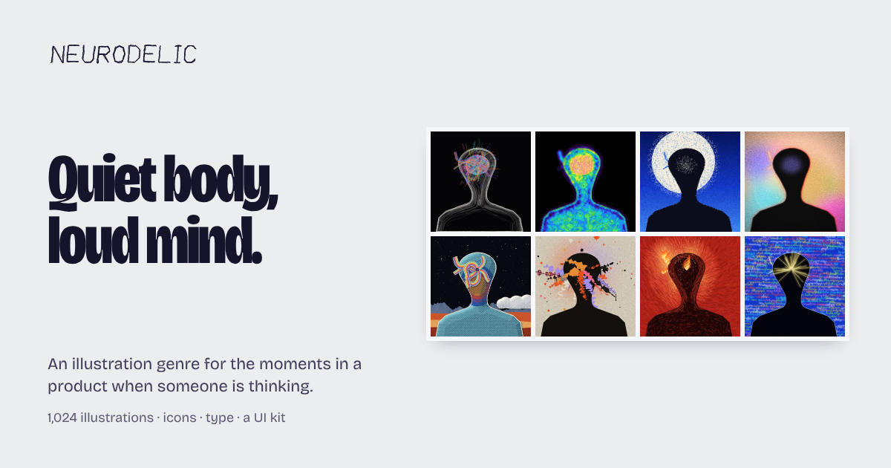

# Neurodelic

**Quiet body, loud mind.** An illustration genre for the moments in a product when someone is thinking, with a library to browse, tune, copy and download it.



Most product illustration draws the outside of people: a flat figure at a laptop, a pastel blob, a smile. The screens that need a picture most (loading, an empty inbox, an error, the moment it clicks) are about what's going on inside someone's head. So I made a genre that keeps the body still and draws the mind.

- **1,024 illustrations**: 32 moments × 8 states of mind × 4 seeds, picked out
- **Endless more**: every other seed is a new picture that keeps to the same rules
- **61 icons** on a 24px grid, in four hands (Scribble, Neon, Stipple, Hatch)
- **Scrawl**, a single-stroke display typeface
- **A UI kit** in plain CSS and React: paper, one ink and a ballpoint pen
- Everything is **drawn by code**: no stock, no image models, no dependencies

Live at **[neurodelic.vincedotcode.com](https://neurodelic.vincedotcode.com)**.

## How a picture is made

Every piece is three choices:

- **A moment**: what is happening, in a product's terms. 32 of them, from New idea and Searching to Broken, Waiting and Welcome. Each has a motif (a spiral for focus, rings for waiting, a crack for broken) and a few ways to frame the figure.
- **A state of mind**: how it feels, which decides the texture and the palette.
- **A seed**: which version.

| State | Texture | Feels like |
|---|---|---|
| Tangle | Contour lines, coloured scribble | A thought you can't stop thinking |
| Thermal | False-colour scan bands | Seeing the heat of a feeling |
| Stipple | Dot shading under a deep sky | Standing still while everything moves |
| Haze | Film grain, soft blur | Letting go and falling into it |
| Collage | Cut paper, halftone, print grain | Daydreaming through space |
| Burst | Paint shards, ink splatter | Too much, all at once |
| Ember | Pen hatching, flame | A feeling that burns |
| Wall | Handwriting, everywhere | Every thought written down at once |

Under the hood, a moment builds a scene (figures as signed-distance fields, a focal point, guide paths, a heat field), and each state draws that same scene in its own hand. That's why one moment reads the same in all eight states. The full system is in the [guide](https://neurodelic.vincedotcode.com/#/guide).

## Use it

From the site: open any piece, tune the state, palette, seed, density, colour and shape, then copy the SVG, a React component or the code, or download a PNG.

From code (browser or Node 18+, nothing to install):

```js
import { renderIllustration } from 'https://neurodelic.vincedotcode.com/src/render.js';

const svg = renderIllustration({ moment: 'thinking', state: 'stipple', seed: 7, aspect: 'wide' });
```

With a coding agent: [`SKILL.md`](SKILL.md) writes the genre down as rules. Drop it into `.claude/skills/neurodelic/SKILL.md` (or your agent's equivalent) and it will pick the right moment and state for each screen and keep new work on-style.

Static files: `/art/{moment}--{state}--{seed}.svg` for the gallery, `/icons/{style}/{name}.svg`, and a machine-readable `/catalog.json`.

UI kit: [`ui/neurodelic.css`](ui/neurodelic.css) and [`ui/react.jsx`](ui/react.jsx), documented at [/#/ui](https://neurodelic.vincedotcode.com/#/ui).

## Develop

No dependencies. Node 18+.

```bash
npm run dev           # http://localhost:5173 (site/, src/, ui/, and /art drawn on request)
npm run check         # every gallery piece plus wide, tall and extreme variants: valid SVG, deterministic, size budget
npm run check:quick   # the same with one seed per pair
npm run build         # static site, the UI kit and all 1,024 SVGs into dist/
```

```
src/
  core/        tokens, seeded noise, SDF shapes, fields and isolines, paths, mark-making
  figures.js   original poses built from signed-distance fields
  scene.js     the 32 moments: layout, motif (focal point, guides, flow, heat)
  states/      the 8 renderers that draw a scene in their own hand
  icons/       icon skeletons and the 4 hands
  type/        Scrawl glyphs
  render.js    renderIllustration() and catalog()
ui/            the UI kit (CSS and React)
site/          the library app (vanilla JS, hash router, a worker pool that draws the art)
scripts/       dev server, build, checks, share image
```

Adding a moment means one entry in `MOMENTS` (and, if it needs one, a motif) in `src/scene.js`; it then exists in all eight states. Adding a state means one renderer in `src/states/` plus its tokens in `src/core/tokens.js`.

Deployed on Vercel (`vercel.json`: build `npm run build`, output `dist`).

## License

Code: MIT. Artwork: free for any project, personal or commercial; just don't resell the library itself as an asset pack. Fonts: SIL Open Font License (see `site/fonts/OFL.txt`). See [LICENSE](LICENSE).

Made by [Vince Erkadoo](https://www.vincedotcode.com).
